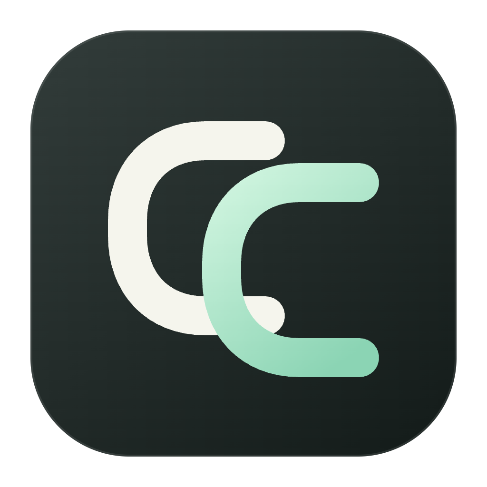

# Codex Coco



A Codex desktop companion, shaped around personal workflows.

[简体中文](README.zh-CN.md)

**Status: macOS Apple Silicon preview, with phase-two core features implemented.** [Version 0.1.0-preview.2](https://github.com/cixiangtao/codex-coco/releases/tag/v0.1.0-preview.2) is available with a project-owned self-signed identity. It is not Apple Developer ID signed or notarized. UI refinement follows core functionality. Controlled tests do not substitute for real-account, current-Codex, signed-update or Widget registration acceptance; see the [phase-two checklist](docs/phase-two.md).

## Download

Get the macOS arm64 DMG or ZIP from [Releases](https://github.com/cixiangtao/codex-coco/releases/tag/v0.1.0-preview.2), verify SHA256SUMS.txt, and move Codex Coco.app to Applications. If macOS says Apple could not verify Codex Coco, dismiss the alert, open **System Settings → Privacy & Security → Open Anyway**, then confirm **Open**. The self-signed identity does not remove this first-launch warning. See the [installation guide](apps/desktop/resources/INSTALL.txt) and [Apple's instructions](https://support.apple.com/102445). No root certificate installation or global Gatekeeper change is required.

Users of preview.1 need one manual upgrade to preview.2. Preview.2 includes automatic version checks and an explicit one-click download, verification and restart. Preview installations follow previews and stable releases; stable installations stay on stable releases. See [release and signing details](docs/releases.md) for the free self-signed identity, build verification and release workflow.

## Features

- Usage: CLI App Server quota windows, reset timing, opt-in background refresh and notifications, incremental local JSONL trends, deduplication, account scoping and read-only SQLite estimates.
- Usage tools: explicitly confirmed reset-card redemption with persisted idempotent recovery, model/effort discovery, structured fixed samples, cancellation, summary history and CLI maintenance.
- Appearance: three independent layers, content-addressed image imports, licensed gallery, named presets, local composition preview, pointer/keyboard positioning and separate save/apply actions.
- Connections: fixed or allocated loopback ports, private application selection, explicit launch/restart, multi-window/reload synchronization, opt-in recovery, computed-style verification and revocation.
- Menu bar: read-only cross-module summaries, quota labels, native/custom icons, 19 licensed GIFs, per-icon speed and optional CPU-linked animation.
- Settings: light/dark/system modes, custom primary color, explicit packaged-app login-item changes, public shared snapshots and update preferences.
- WidgetKit: native extension source and shared-state contract, typechecked but not signed or registered.
- Application updates: manual or opt-in scheduled checks against [GitHub Releases](https://github.com/cixiangtao/codex-coco/releases), including unsigned builds; release-page downloads, confirmed native download/checksum validation, cancellation and explicit installation/relaunch for signed macOS apps. No stable release is published yet.

## Contributing and support

Report bugs and propose improvements in [GitHub Issues](https://github.com/cixiangtao/codex-coco/issues). See [CONTRIBUTING.md](CONTRIBUTING.md) for development requirements and [SECURITY.md](SECURITY.md) for private vulnerability reports. English is the primary language for public entry points and community files. The Chinese companion covers core features, development and data boundaries; detailed engineering documentation is currently mostly Chinese.

## Development

Use Node.js 24 and pnpm 12.14.0.

```sh
pnpm install --frozen-lockfile
pnpm run dev
pnpm run check
pnpm run verify:packaged
```

`check` runs Oxfmt, Oxlint, Oxc AST dependency checks, process-specific TypeScript checks, contract tests and production builds. `verify:packaged` builds a local unsigned macOS arm64 directory and runs the controlled desktop workflows listed in package.json. `pnpm run pack` never publishes; keep `run` to avoid pnpm's npm-package command.

Optional `verify:appearance-launcher` and `verify:widget` require an existing Swift compiler and macOS SDK; they do not install a toolchain. See package.json for individual desktop and usage verification commands. Run production files using `pnpm run build` followed by `pnpm run start`.

## Architecture and data

`apps/desktop` owns the Electron host, application services, contracts, renderer and independent `usage`, `appearance`, `desktop-tools` modules. `packages/ui` owns Tailwind/shadcn components and theme primitives without Node, Electron, IPC or storage dependencies. `native/widget` contains the native extension source. Task workers have static build entries, bounded messages and real cancellation/exit verification.

Business modules are disabled by default. Enabled usage modules read on startup; recurring reads and failure fallback use separately saved policies. Model inference, credit redemption and CLI updates require their own confirmations. Credentials stay with the CLI. Sample answers are excluded from persisted history, diagnostics and menu-bar projections.

Usage stays disabled by default. An enabled module reads once on startup; recurring refresh is a separate setting. Restart restores only the last successful public quota, labeled as historical until refreshed. New windows share the same runtime.

The main window hosts full operations; the menu-bar popover receives only public summaries and cannot write. Failures hide old quota values. Appearance saving and previewing do not apply changes. Opt-in restoration reconnects without automatically launching or restarting Codex; shutdown removes only Codex Coco styles.

Settings default to `~/Library/Application Support/Codex Coco/foundation/`; override with `CODEX_COCO_DATA_DIR` for isolated development. Old repositories, settings and services are untouched. Diagnostics exclude private paths, account data, configuration contents and raw exceptions. There is no telemetry or cloud synchronization.

New installations check for updates after startup and daily, with an option to disable checks. Checks never download automatically. Clicking Update and Restart consents to download, verify and restart; ordinary quit never automatically installs an update. A complete update between two public Codex Coco versions and Widget App Group registration remain unverified. Preview.2 includes the [original double-C app icon](docs/branding.md). Preview distribution uses a self-signed identity without Apple notarization. See [updates](docs/updates.md), [appearance](docs/appearance.md), [verification](docs/verification.md), [architecture](docs/architecture.md) and [third-party notices](THIRD_PARTY_NOTICES.md).

Performance scripts provide isolated machine-specific measurements. No new performance baseline was established for this feature batch.

MIT. Codex Coco is an independent project and is not affiliated with OpenAI.
