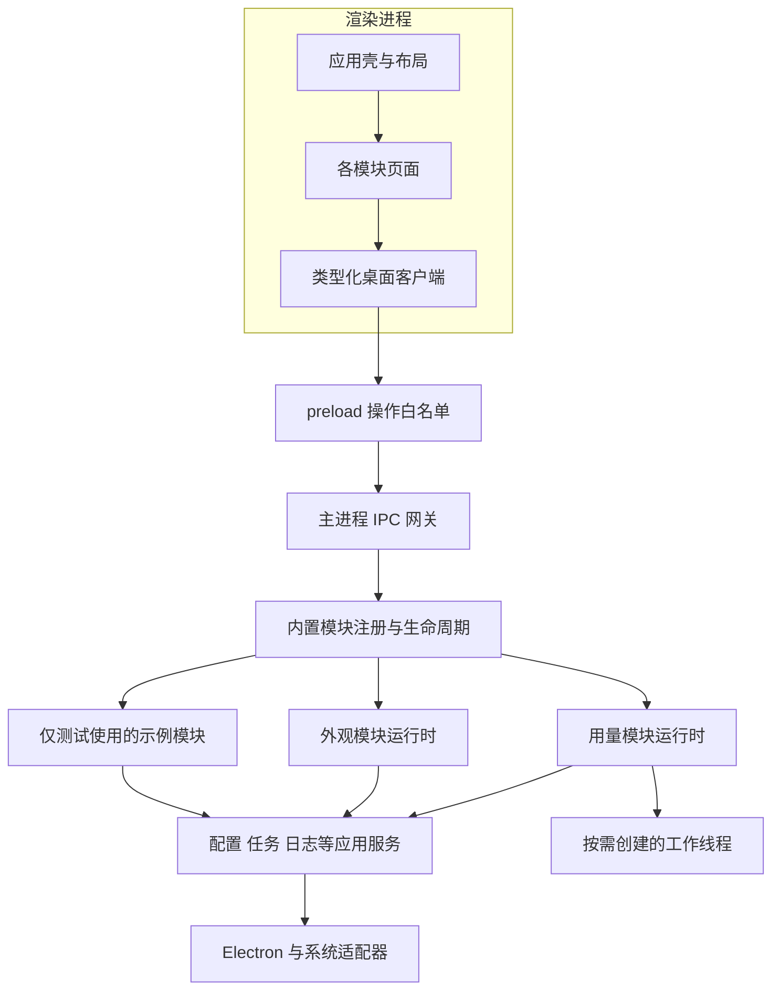

# Codex Coco 基建方案

日期：2026-10-21。状态：从零建立的工程基线、独立 UI/根主题和运行时基础已落地；完整 F01–F15 目标仍有后续项，详见 [验证记录](verification.md)。

Codex Coco 从零建立工程和架构基础，同时确定整页设计方向，再逐个实现业务功能。原型已从工作树移除，源码与历史记录在清理前做了仓库外归档；其布局、绿色主题、组件库和窗口尺寸不作为正式设计基线。详见 [原型清理记录](prototype-reset.md)。

第一阶段基建的完成标准是：不用读取真实账号、不用连接真实 Codex，也能验证一个模块从注册、启动、执行、取消、保存到退出的完整过程；换一套页面布局时，后台业务与模块合同不需要重写。

## 已确认的边界

- 软件始终使用完整名称 **Codex Coco**，机器标识使用 `codex-coco`。
- 使用 Electron，首先支持并验证 macOS。
- UI 使用 Tailwind CSS + shadcn/ui 构建 Codex Coco 自有组件，不延续原型的 Ant Design 实现。
- UI 组件独立为 packages/ui，通过 pnpm workspace 供桌面应用消费；支持主题切换与自定义主题色。
- 项目统一使用 pnpm 管理依赖与运行脚本。
- 格式化使用 Oxfmt，代码检查使用 Oxlint，依赖边界使用 Oxc parser AST 检查。
- 使用独立的本地仓库，保留两个旧项目，不创建远端、不推送；功能变更验证通过后自动本地提交。
- 中文主文档、英文说明，界面先使用中文。
- 首批业务范围是用量和外观，后续可以增加更多内置模块。
- 个人使用习惯、学习与持续打磨是项目价值，不以追赶其他仓库的功能数量为目标。
- 当前暂停新增功能。新设计方向经用户确认后，才继续正式界面实现。

## 建议采用的基线

| 项目           | 建议                                                 | 原因与边界                                                                    |
| -------------- | ---------------------------------------------------- | ----------------------------------------------------------------------------- |
| 仓库组织       | pnpm workspace：apps/desktop + packages/ui           | 独立 UI 包已由用户明确要求；首期只拆桌面应用与 UI 包，不把每个业务模块拆成包  |
| 桌面宿主       | Electron                                             | 已由用户确定；主进程负责系统入口与应用组合                                    |
| 界面与业务语言 | React、TypeScript                                    | 按新合同实现；业务逻辑与 React 分离                                           |
| 开发环境       | Node.js 24、pnpm 12.14.0                             | 最小 workspace 已建立，只保留 pnpm-lock.yaml                                  |
| 构建与打包     | electron-vite 6.0.0、electron-builder 26.15.3        | 已核对稳定版本及 peer 兼容范围，真实构建与本地应用目录已验证                  |
| 模块机制       | 静态注册的内置模块，后台与界面分别加载               | 增加模块走统一接入路径；不执行外部下载的模块代码                              |
| 数据合同       | TypeScript + Zod                                     | 主题、配置和模块操作 IPC 使用严格运行时校验                                   |
| 配置           | 应用配置与模块配置分开版本化                         | 模块可以独立迁移与恢复，重新建立原子写入合同                                  |
| 后台任务       | 归属明确、支持取消、有清理结果                       | 页面退出不决定任务生命周期；重计算按成本放到工作线程                          |
| 格式化         | Oxfmt                                                | 用户已选择 Oxc 格式化；统一配置与 format、format:check 脚本，不再另选格式化器 |
| 工程检查       | Oxfmt、Oxlint、Oxc AST、分进程 TypeScript            | 工具各司其职，边界反例测试确保违规导入失败                                    |
| 界面基础       | packages/ui 中维护 Tailwind CSS + shadcn/ui 自有组件 | 基础控件、主题与语义 token 共享；业务页面留在应用，整体视觉方向仍需确认       |
| 主题能力       | 浅色、深色、跟随系统；预设和自定义主色独立设置       | UI 包负责渲染与 token，应用负责偏好持久化、恢复和多窗口同步                   |
| 测试           | Vitest 5.0.5、Playwright 1.64.1                      | 合同测试与真实 Electron/打包应用回归；不使用个人数据                          |

先不引入动态插件商店、第三方插件 SDK、通用依赖注入容器、微前端、独立模块发布系统。全局状态库、路由库和 SQLite 在出现明确需求后再评估，不为目录完整提前安装。

## 原型经验与重新实现的边界

原型曾验证独立模块启停、后台用量读取、工作线程回退、设置原子写入和合成数据桌面回归，也暴露出主进程业务分支集中、共享合同绑定首批模块、全局修改队列、退出缺少截止、配置迁移链不足、页面状态混合和类型环境边界不清等问题。

这些发现用于定义新合同，不要求保留原型代码或接口。原型源码、测试、设计记录和构建配置均已清理，不将旧引擎直接搬回作为默认实现；旧仓库仍可供参考，实际复用需重新核对来源与许可。

原型曾通过的 38 项测试、构建与界面审查属于历史结果，随原型归档，不代表当前骨架具备对应能力，也不能代替用户的视觉认可。新基建按下方验收场景重新编写测试。

## 应用架构

### 进程和依赖方向

React 页面负责展示和本地交互。preload 只暴露明确操作。主进程中的组合入口负责装配应用服务、模块和 Electron 适配器；业务核心不直接导入 Electron 或 React。文件扫描与重计算根据成本放到工作线程，原生系统能力通过适配器提供。



后台模块代码不能被 renderer 的注册入口导入。共享清单只包含 ID、标签等可序列化元数据；运行时和 React 页面分别注册，界面按需加载。模块之间不直接调用，由宿主提供明确的共享服务或组合操作。

沙箱、contextIsolation、关闭 nodeIntegration、限制导航及验证 IPC 调用方作为基础约束落实；preload 不透出原始事件对象和通用 IPC。相关边界按 [Electron 安全建议](https://www.electronjs.org/docs/latest/tutorial/security) 验证。

### 目标目录

```text
apps/
  desktop/
    src/
      desktop/
        main/             窗口、菜单栏、系统入口和组合根
        preload/          操作白名单与事件转发
      application/
        modules/          注册、生命周期、状态与操作分发
        services/         配置、任务、错误和日志
      contracts/          应用级纯数据合同，不含业务大快照
      renderer/
        shell/            应用壳与可替换布局
        theme/            共享主题能力的应用适配与设置交互
        client/           类型化调用与订阅
      modules/
        usage/            用量合同、运行时与业务页面
        appearance/       外观合同、运行时、业务页面与系统适配
packages/
  ui/
    src/
      components/         自有基础控件与通用组合
      theme/              主题合同、预设、解析和 Provider
      styles/             语义变量与 Tailwind 映射
      hooks/
      lib/
    components.json
    package.json
pnpm-workspace.yaml
pnpm-lock.yaml
```

这是职责目标，当前实现状态以架构和验证记录为准。需要时按合同创建目录，不创建空实现或自动搬回旧引擎来填满目录。

### 模块合同

| 合同项       | 必须表达的内容                                           |
| ------------ | -------------------------------------------------------- |
| 身份与元数据 | 稳定 ID、完整标签、所需后台能力与可选页面贡献            |
| 配置         | 默认值、schemaVersion、校验、迁移和变更后的应用策略      |
| 生命周期     | start、stop，支持取消，重复调用的行为明确                |
| 资源归属     | 请求、定时器、工作线程、监听、子进程与清理责任           |
| 操作         | 固定命名的输入/结果合同，按模块串行化或允许只读并发      |
| 状态         | 用户期望启用、运行时阶段、业务可用性、数据新鲜度分别表示 |
| 界面接入     | 从 renderer 注册入口增加页面，页面不持有后台对象         |

“已启用”只代表用户期望或模块已启动，不等于网络可用或背景已应用。设置已保存、正在应用、已经生效也要分别表示。启停状态由模块管理器维护，业务状态由模块报告，避免互相冒充。

基建使用一个仅在测试或开发场景注册的示例模块验收扩展性。新增示例模块只应修改它自己的目录和前后台注册入口，不应改主窗口、通用 IPC 网关或现有业务模块。

## 配置和后台任务

### 配置生命周期

应用级设置保存语言、窗口等通用偏好；每个模块维护自己的版本与数据。模块默认值、序列化合同和迁移函数与具体 UI 控件分离。

读取旧版本时，按迁移链生成候选配置，校验通过后备份原文件并原子写入；重复执行得到相同结果。遇到未来版本或损坏配置，保留原文件并提供可理解的恢复入口。新实现自身的配置版本升级要有迁移样本。已有原型数据目录保留，不自动读取、覆盖或承诺兼容；未来如需导入，再明确设计。

跨模块保存通过配置服务合并到最新 revision，防止两个操作各自基于旧快照覆盖对方。磁盘持久化串行化，网络请求、主题连接和界面等待不占用配置写入锁。

### 后台任务生命周期

任务记录所属模块、操作 ID、取消信号和截止时间。模块关闭或应用退出时，先阻止新任务，再发出取消，最后等待资源释放；恢复动作只操作本应用持有的资源。

每模块串行修改，互不相关模块可以同时工作。同一数据源的重复刷新可以合并，但不同模块不能因为共享一个 busy 或长队列而互相锁住。配置变化由模块决定即时应用还是重启自身任务，界面保留未保存草稿。

网络请求、worker 和子进程分别定义超时。仅 Promise.race 超时不代表任务已结束：清理失败必须保留错误状态与诊断信息；不得为通过检查而终止其他应用。

主进程不执行阻塞扫描或重计算；延迟加载非必要能力，并分别测量窗口打开与后台常驻成本。这与 [Electron 性能指南](https://www.electronjs.org/docs/latest/tutorial/performance) 的原则一致。

## 桌面桥和诊断

IPC 网关验证调用方、操作名和运行时输入。模块注册表提供确定的操作集合，不接受任意文件路径执行、任意 shell 或任意通道名。TypeScript 类型用于开发期提示，不能代替运行时校验。

操作统一返回成功值或包含 code、用户消息、是否可重试和关联 ID 的错误；详情只进入经过脱敏的本地诊断。数据推送至少携带模块 ID、revision 与本次启用的 generation，防止禁用或重连后的旧结果覆盖新状态。

记录模块、操作、耗时、结果与错误码。凭据、原始响应、账号标识、会话正文和图片内容不进入日志。正常取消不显示成故障，真实异常也不能被统一吞掉。诊断日志有大小和保留数量限制，界面显示可操作的短消息。

## 工程与本地交付

### 工具链约定

统一使用 pnpm，packageManager 已锁定 12.14.0，Node.js 为 24。旧 Bun 依赖树与锁文件已清理，从干净目录安装新骨架；只保留 pnpm-lock.yaml。新增应用依赖时单独验证兼容性，不照搬原型依赖清单。workspace 与 workspace:* 关系按 [pnpm 官方文档](https://pnpm.io/workspaces) 落实。

格式化统一使用 Oxc 的 [Oxfmt](https://oxc.rs/docs/guide/usage/formatter/quickstart.html)，已接入项目内开发依赖 0.74.0、配置和生成物忽略规则，提供 format 与 format:check；Tailwind 类名排序能力按所选 Oxfmt 版本核对配置。源码重建时同步维护来源记录。lint 是独立检查，不能用 Oxfmt 格式化成功代替。

Node 与 pnpm 的开发版本有明确入口，依赖升级按兼容性验证单独进行。构建工具已重新核对并锁定稳定版本，版本选择和运行结果见验证记录；不继承原型 beta 版本。

已提供 format、format:check、lint、typecheck、test、build、check、verify:desktop、verify:modules、verify:diagnostics、profile:desktop、profile:packaged、pack 与 verify:packaged。check 汇总格式、lint、边界、类型、测试和构建；真实桌面回归单独执行，不因编辑文档启动应用。

后台、preload、渲染器和纯合同分别检查类型与导入边界。检查规则应阻止 renderer 导入 Electron/Node、纯合同导入具体宿主、模块跨目录调用其他业务运行时。不要只靠开发者自觉维持这些约束。

### 本地应用包

基建需要验证本地应用目录能够启动，且 worker、preload、渲染静态文件、图标占位与许可证均在预期位置；验证正式构建中的本地协议和 CSP。开发服务器白名单只存在于开发模式，评估采用受限自定义协议加载本地内容。

这一步不包含自动更新、签名、公证和公开发布。没有远端时不新增 GitHub 发布流程，也不创建配套仓库。未来启用远端后再把已验证的本地命令接入 CI。

### 性能记录

先在同一台机器、同一构建和相同数据样本下记录：冷启动到窗口可操作、后台首次就绪、窗口开着时空闲、窗口关闭后常驻、日志任务峰值。内存统计覆盖所有应用子进程。

性能阈值在获得基线后再确定，不承诺尚未测量的常驻内存数字。立即可验收的约束是关闭窗口释放 renderer、禁用模块不残留自有任务、重复启停不重复创建轮询、重计算不阻塞界面交互。

## 设计基础和确认方式

### 已确定的组件技术路线

使用 Tailwind CSS + shadcn/ui 构建可定制的自有组件。shadcn/ui 提供可纳入项目并修改的组件源码，符合 [官方的源码所有权与组合方式](https://ui.shadcn.com/docs)。它提供基础交互能力，不替代 Codex Coco 的整页设计。

组件按职责组织：packages/ui 管理基础控件、主题与语义 token，各模块 ui 目录组织业务复合组件，renderer/shell 负责窗口布局与导航组合。普通页面用 className 组织布局；反复出现的外观差异进入基础组件变体，避免页面各自覆盖颜色和字号。组件包不依赖 Electron、IPC 或业务设置，桌面应用通过 workspace 依赖消费公开导出。

后续按 apps/desktop 与 packages/ui 配置 Tailwind、components.json 和别名，不用新建 Vite 网站模板覆盖桌面工程。共享主题样式只维护一个入口，构建时覆盖 UI 包的源码扫描。只加入需要的组件，逐项检查源码、交互与键盘可用性。底层 primitive、图标集和 preset 在初始化时根据项目需求确定，不把默认 preset 当作已认可的视觉稿。

具体包边界、主题合同和验收场景见 [UI 组件包与主题方案](ui-package-and-theme.md)。这套主题控制 Codex Coco 自身界面，与外部 Codex 的布景业务配置分离。

Ant Design 原型与依赖已移除。新组件按 Tailwind CSS + shadcn/ui 方案实现。

### 仍待确认的设计选择

旧 DESIGN.md 已从工作树移除，仅在原型归档中保留。绿色调色板、双 C 标记、固定侧栏、概览卡片、字号和页面宽度均可重新评估。通过界面审查只能说明原型可用，不能说明用户已接受它的审美。

组件技术路线已确定，后续用完整界面验证信息组织、日常操作路径与控件组合效果。不能仅将现有控件换成 shadcn/ui，就认为已解决整体布局与审美问题。

### 后续设计评审材料

使用同一组脱敏或合成内容，给出两到三种完整窗口方案，并保持相同任务与状态覆盖。区别应体现在导航方式、窗口组织、内容密度、操作路径和整体视觉语言，不能只有配色区别。

每个方案至少展示一处信息密集页面、一处设置交互以及加载、无数据和失败状态。菜单栏快速查看与完整窗口的分工在这一轮讨论；现在不把“每个模块一项侧栏”固化为唯一结构。

评审要回答：打开后最先看到什么，常用任务需要几步，信息多时是否仍清楚，模块变多后如何组织，macOS 窗口与键盘操作是否自然。用户确认方向后，再提取字号、间距、色彩、层次、动效和控件组合规则，并通过真实 Electron 交互验证。

### 可以现在确定的界面约束

完整产品名称、来源与采集时间、保存与生效的区分、清晰的加载/空/错误状态、键盘可用性和可读性持续保留。状态与 token 使用语义名称；主题基建支持浅色、深色、跟随系统、预设切换与自定义主色。具体主题外观由设计评审确定，弹层、焦点与其他状态必须一起覆盖。

界面布局可以通过合成数据独立运行，不要求真实凭据或主题连接。示意图必须标注用途，不把布局草图当作真实 Codex 注入效果。

## 实施顺序和验收

| 阶段             | 工作与交付                                                          | 通过条件                                                          |
| ---------------- | ------------------------------------------------------------------- | ----------------------------------------------------------------- |
| 起点清理         | 原型仓库外归档、源码/依赖清理、workspace 与 Oxfmt 骨架              | 该阶段完成归档清理；后续运行时与主题基线现已接入                  |
| 工程与运行时基建 | 工具链检查、分进程边界、注册与任务/配置/错误合同、示例模块          | 下表的架构与运行测试通过；不迁移更多业务功能                      |
| UI 包与主题基建  | workspace UI 包、公开导出、语义 token、主题 Provider 与应用偏好适配 | 独立消费、生产构建样式、明暗/主色切换、弹层继承与偏好恢复验证通过 |
| 完整界面方向     | 两到三种可比较的窗口方案，选定方向后的布局与控件样本                | 用户认可整页组合，再完成桌面交互验证                              |
| 首个模块实现     | 先按已确定的合同和界面实现用量模块                                  | 数据行为与界面状态一致，重新建立合同测试；随后处理外观            |

工程基建和界面方向可以独立推进，但业务功能迁移要等两者都有明确基线。

### 基建验收清单

| 编号 | 验收场景                       | 应有结果                                                                                                                       |
| ---- | ------------------------------ | ------------------------------------------------------------------------------------------------------------------------------ |
| F01  | 干净安装与构建                 | pnpm install --frozen-lockfile 可复现；最终只有 pnpm 锁文件，脚本无 Bun 调用；Oxfmt 检查、开发启动、构建和本地应用目录启动成功 |
| F02  | 非法跨进程导入                 | renderer 导入 Node/Electron 或纯合同导入宿主会使自动检查失败                                                                   |
| F03  | 添加仅测试使用的示例模块       | 只改模块和注册入口，原有模块及窗口/网关不需要业务分支                                                                          |
| F04  | 连续启用、禁用，再次启用       | 状态一致，无重复定时器、监听、worker 或旧结果回写                                                                              |
| F05  | 一个模块长操作时修改另一个模块 | 无关操作可以完成，配置最终包含双方修改                                                                                         |
| F06  | 启动失败或任务不响应           | 有限等待、报告真实状态，其他模块继续使用；不把超时当清理成功                                                                   |
| F07  | 旧版本、损坏、未来版本设置     | 迁移可重复，备份可恢复，损坏/未来版本原文件不被覆盖                                                                            |
| F08  | 非法调用、无效输入与订阅注销   | 网关拒绝非法操作；事件不透出 Electron 对象；注销后不继续回调                                                                   |
| F09  | 关闭窗口、重开、退出           | 后台按约定持续；重开恢复状态；退出取消任务并收集清理结果                                                                       |
| F10  | 无凭据、无网络、失败与恢复     | 合成数据可覆盖状态，界面不解析底层异常，不残留永久 busy                                                                        |
| F11  | 诊断和性能采样                 | 日志脱敏且有界；记录完整进程资源；禁用模块无自有后台任务                                                                       |
| F12  | 已认可设计的组合与交互         | 密集内容、长文案和状态切换可读可操作，风格由用户确认而非测试结果推定                                                           |
| F13  | workspace UI 包与共享样式      | UI 包不依赖宿主和业务，应用通过公开导出使用，生产构建包含共享包组件样式                                                        |
| F14  | 主题模式、预设和自定义主色     | 三者独立；弹层/焦点/禁用状态一致；非法输入不覆盖有效主题，配色可读                                                             |
| F15  | 主题偏好生命周期               | 预览可取消、恢复预设、持久化和重开恢复、多窗口同步；首屏无明暗闪烁                                                             |

模块闭环迭代已用显式开启的合成示例证明接入、取消、独立配置与迁移；已补充有界诊断及本机性能基线。完整界面方案作为单独的设计交付，方向确认前不恢复业务页面。

## 当前实施范围

2026-10-21 已从零接入 Electron、React、TypeScript、Tailwind、shadcn 自有组件、Oxfmt 与 Oxlint。UI 包支持根主题能力，应用具备受限生产协议、沙箱桥、配置服务、多窗口同步和模块生命周期基础；业务模块注册为空。

正式主窗口已接入认可的精简侧栏与主题设置，业务注册表仍为空。模块操作分发、独立配置迁移和合成示例验收已落地；菜单栏状态速览已接入，真实业务与 worker 服务继续推进；本地有界日志与性能采样基线已落实；局部主题预览作用域也尚未实现。F01–F15 不标记为全部完成。

实际工具、测试、桌面与本地应用结果见 [开发验证](verification.md)。没有改动旧仓库或应用数据，没有请求真实额度或应用外部主题。代码仅在本地维护；功能变更验证通过后自动提交到本地，不自动创建远端或推送。

诊断与性能迭代已落实固定字段日志、关联 ID、字节轮转、有界内存队列和限时退出排空，并建立生产文件与打包应用的本机启动/全进程采样。实际口径见 [诊断与性能](diagnostics-and-performance.md)；基线不作为性能预算或全部 F01–F15 完成声明。
